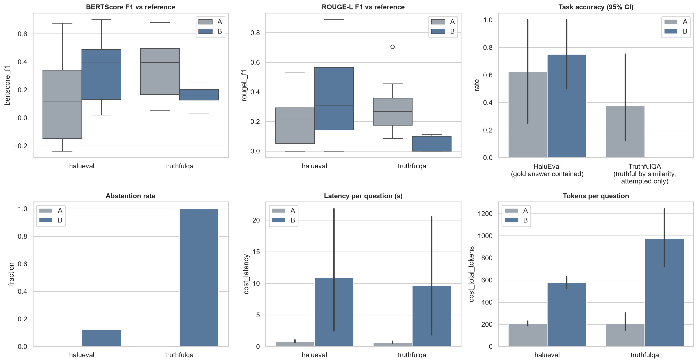
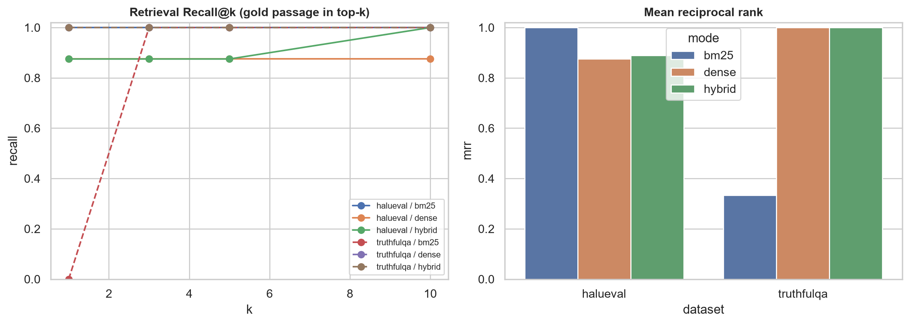
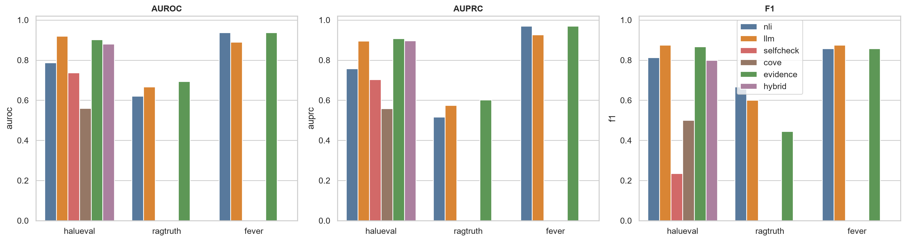
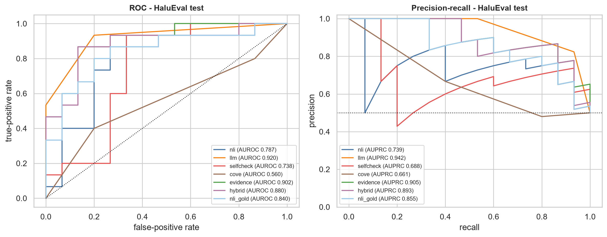
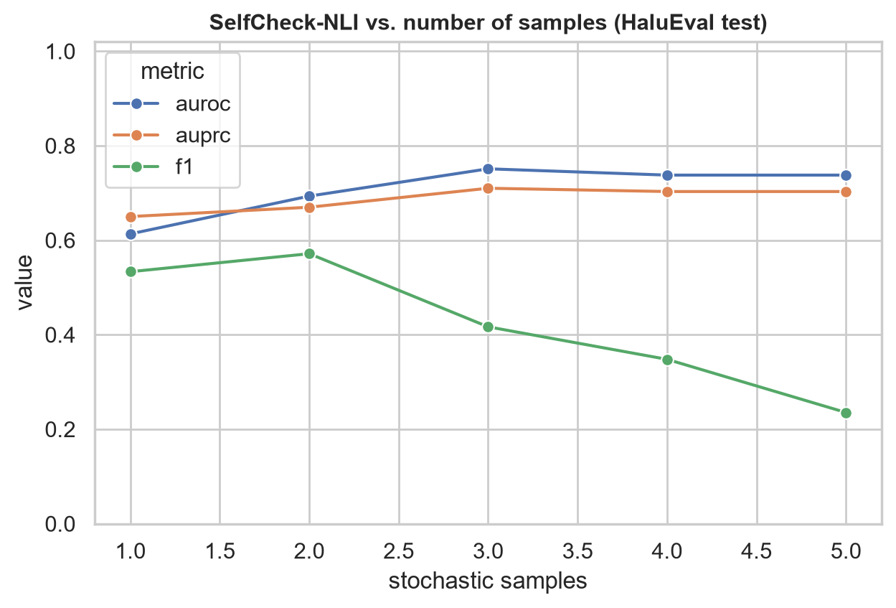
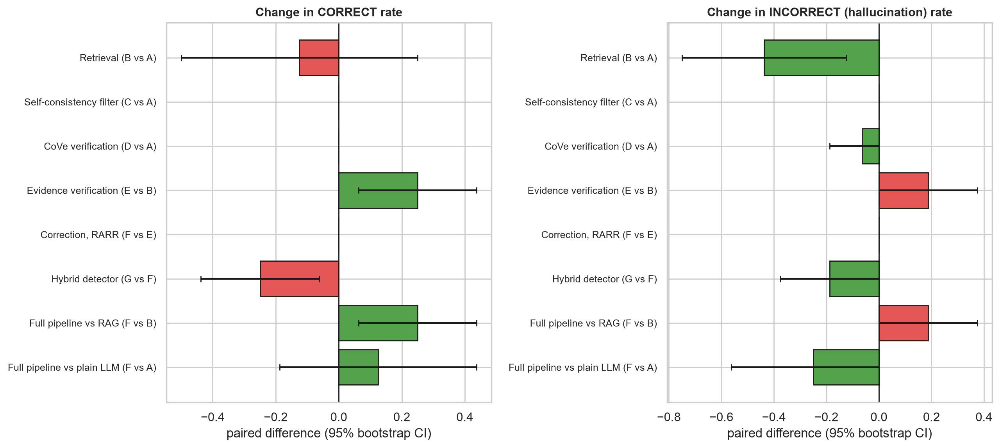
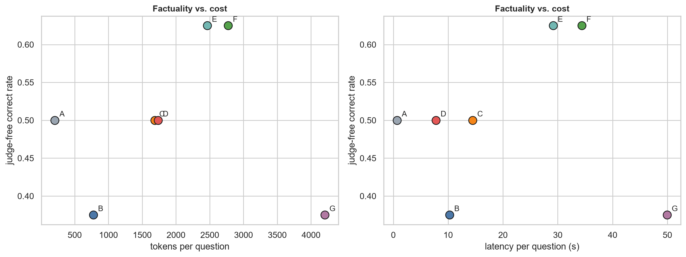
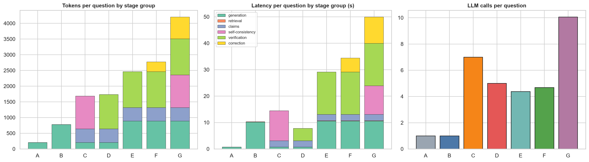

# Results report (auto-generated)

## Stage 1 - baselines & retrieval

_run 2026-10-30T19:41:32 | model `openai/gpt-oss-20b` | judge `openai/gpt-oss-120b` | embedder `sentence-transformers/all-MiniLM-L6-v2` | NLI `cross-encoder/nli-deberta-v3-base`_

### Retrieval quality (gold passage in top-k)

| dataset | mode | recall@1 | recall@3 | recall@5 | recall@10 | mrr | n |
|---|---|---|---|---|---|---|---|
| halueval | bm25 | 1.000 | 1.000 | 1.000 | 1.000 | 1.000 | 10 |
| halueval | dense | 0.900 | 0.900 | 0.900 | 0.900 | 0.900 | 10 |
| halueval | hybrid | 0.900 | 0.900 | 0.900 | 1.000 | 0.911 | 10 |
| truthfulqa | bm25 | 0.000 | 1.000 | 1.000 | 1.000 | 0.333 | 1 |
| truthfulqa | dense | 1.000 | 1.000 | 1.000 | 1.000 | 1.000 | 1 |
| truthfulqa | hybrid | 1.000 | 1.000 | 1.000 | 1.000 | 1.000 | 1 |

### Baselines A (LLM only) / B (hybrid RAG)

| dataset | system | n | abstention_rate | bertscore_f1 | rougeL_f1 | contains | tqa_truthful_sim | cost_calls | cost_prompt_tokens | cost_completion_tokens | cost_latency |
|---|---|---|---|---|---|---|---|---|---|---|---|
| halueval | A | 10 | 0.000 | 0.103 | 0.157 | 0.300 |  | 1.000 | 119.600 | 94.200 | 1.502 |
| halueval | B | 10 | 0.300 | 0.337 | 0.348 | 0.500 |  | 1.000 | 518.700 | 54.800 | 4.993 |
| truthfulqa | A | 1 | 0.000 | 0.366 | 0.176 |  | 0.000 | 1.000 | 101.000 | 84.000 | 0.311 |
| truthfulqa | B | 1 | 1.000 | 0.147 | 0.000 |  |  | 1.000 | 1321.000 | 33.000 | 0.579 |

## Stage 2 - hallucination detection

_run 2026-10-30T19:50:55 | model `openai/gpt-oss-120b` | judge `openai/gpt-oss-120b` | embedder `sentence-transformers/all-MiniLM-L6-v2` | NLI `cross-encoder/nli-deberta-v3-base`_

### Detection metrics (thresholds calibrated on HaluEval dev with Youden's J)

| dataset | detector | n | pos_rate | threshold | accuracy | precision | recall | f1 | auroc | auprc |
|---|---|---|---|---|---|---|---|---|---|---|
| halueval | nli | 30 | 0.500 | 0.981 | 0.800 | 0.765 | 0.867 | 0.812 | 0.787 | 0.757 |
| halueval | llm | 30 | 0.500 | 0.500 | 0.867 | 0.824 | 0.933 | 0.875 | 0.920 | 0.896 |
| halueval | selfcheck | 30 | 0.500 | 1.000 | 0.567 | 1.000 | 0.133 | 0.235 | 0.738 | 0.703 |
| halueval | cove | 30 | 0.500 | 1.000 | 0.600 | 0.667 | 0.400 | 0.500 | 0.560 | 0.559 |
| halueval | evidence | 30 | 0.500 | 0.625 | 0.867 | 0.867 | 0.867 | 0.867 | 0.902 | 0.908 |
| halueval | hybrid | 30 | 0.500 | 0.393 | 0.767 | 0.700 | 0.933 | 0.800 | 0.880 | 0.896 |
| halueval | nli_gold | 30 | 0.500 | 0.981 | 0.800 | 0.765 | 0.867 | 0.812 | 0.840 | 0.860 |
| halueval | nli_bm25 | 30 | 0.500 | 0.005 | 0.633 | 0.583 | 0.933 | 0.718 | 0.822 | 0.838 |
| halueval | nli_dense | 30 | 0.500 | 0.981 | 0.767 | 0.700 | 0.933 | 0.800 | 0.733 | 0.695 |

## Stage 3 - ablation

_run 2026-10-30T20:15:16 | model `openai/gpt-oss-120b` | judge `openai/gpt-oss-120b` | embedder `sentence-transformers/all-MiniLM-L6-v2` | NLI `cross-encoder/nli-deberta-v3-base`_

### Ablation (all questions)

| system | n | free_correct | free_incorrect | cost_calls | cost_total_tokens | cost_latency |
|---|---|---|---|---|---|---|
| A | 16 | 0.500 | 0.500 | 1.000 | 206.062 | 0.696 |
| B | 16 | 0.375 | 0.062 | 1.000 | 777.438 | 10.273 |
| C | 16 | 0.500 | 0.500 | 7.000 | 1683.938 | 14.472 |
| D | 16 | 0.500 | 0.438 | 5.000 | 1736.188 | 7.781 |
| E | 16 | 0.625 | 0.250 | 4.375 | 2463.188 | 29.147 |
| F | 16 | 0.625 | 0.250 | 4.688 | 2773.875 | 34.381 |
| G | 16 | 0.375 | 0.062 | 10.062 | 4203.938 | 49.947 |

### Paired contrasts

| scope | contrast | n | delta_correct | correct_lo | correct_hi | delta_incorrect | incorrect_lo | incorrect_hi | mcnemar_p | only_baseline_correct | only_system_correct | outcome |
|---|---|---|---|---|---|---|---|---|---|---|---|---|
| all | Retrieval (B vs A) | 16 | -0.125 | -0.500 | 0.250 | -0.438 | -0.750 | -0.125 | 0.727 | 5 | 3 | judge-free |
| all | Self-consistency filter (C vs A) | 16 | 0.000 | 0.000 | 0.000 | 0.000 | 0.000 | 0.000 | 1.000 | 0 | 0 | judge-free |
| all | CoVe verification (D vs A) | 16 | 0.000 | 0.000 | 0.000 | -0.062 | -0.188 | 0.000 | 1.000 | 0 | 0 | judge-free |
| all | Evidence verification (E vs B) | 16 | 0.250 | 0.062 | 0.438 | 0.188 | 0.000 | 0.375 | 0.125 | 0 | 4 | judge-free |
| all | Correction, RARR (F vs E) | 16 | 0.000 | 0.000 | 0.000 | 0.000 | 0.000 | 0.000 | 1.000 | 0 | 0 | judge-free |
| all | Hybrid detector (G vs F) | 16 | -0.250 | -0.438 | -0.062 | -0.188 | -0.375 | 0.000 | 0.125 | 4 | 0 | judge-free |
| all | Full pipeline vs RAG (F vs B) | 16 | 0.250 | 0.062 | 0.438 | 0.188 | 0.000 | 0.375 | 0.125 | 0 | 4 | judge-free |
| all | Full pipeline vs plain LLM (F vs A) | 16 | 0.125 | -0.188 | 0.438 | -0.250 | -0.562 | 0.000 | 0.688 | 2 | 4 | judge-free |
| halueval | Retrieval (B vs A) | 8 | 0.125 | -0.375 | 0.625 | -0.250 | -0.691 | 0.191 | 1.000 | 2 | 3 | judge-free |
| halueval | Self-consistency filter (C vs A) | 8 | 0.000 | 0.000 | 0.000 | 0.000 | 0.000 | 0.000 | 1.000 | 0 | 0 | judge-free |
| halueval | CoVe verification (D vs A) | 8 | 0.000 | 0.000 | 0.000 | 0.000 | 0.000 | 0.000 | 1.000 | 0 | 0 | judge-free |
| halueval | Evidence verification (E vs B) | 8 | 0.125 | 0.000 | 0.375 | 0.000 | 0.000 | 0.000 | 1.000 | 0 | 1 | judge-free |
| halueval | Correction, RARR (F vs E) | 8 | 0.000 | 0.000 | 0.000 | 0.000 | 0.000 | 0.000 | 1.000 | 0 | 0 | judge-free |
| halueval | Hybrid detector (G vs F) | 8 | -0.125 | -0.375 | 0.000 | -0.125 | -0.375 | 0.000 | 1.000 | 1 | 0 | judge-free |
| halueval | Full pipeline vs RAG (F vs B) | 8 | 0.125 | 0.000 | 0.375 | 0.000 | 0.000 | 0.000 | 1.000 | 0 | 1 | judge-free |
| halueval | Full pipeline vs plain LLM (F vs A) | 8 | 0.250 | -0.191 | 0.691 | -0.250 | -0.691 | 0.191 | 0.625 | 1 | 3 | judge-free |
| truthfulqa | Retrieval (B vs A) | 8 | -0.375 | -0.750 | 0.000 | -0.625 | -1.000 | -0.250 | 0.250 | 3 | 0 | judge-free |
| truthfulqa | Self-consistency filter (C vs A) | 8 | 0.000 | 0.000 | 0.000 | 0.000 | 0.000 | 0.000 | 1.000 | 0 | 0 | judge-free |
| truthfulqa | CoVe verification (D vs A) | 8 | 0.000 | 0.000 | 0.000 | -0.125 | -0.375 | 0.000 | 1.000 | 0 | 0 | judge-free |
| truthfulqa | Evidence verification (E vs B) | 8 | 0.375 | 0.125 | 0.750 | 0.375 | 0.125 | 0.750 | 0.250 | 0 | 3 | judge-free |
| truthfulqa | Correction, RARR (F vs E) | 8 | 0.000 | 0.000 | 0.000 | 0.000 | 0.000 | 0.000 | 1.000 | 0 | 0 | judge-free |
| truthfulqa | Hybrid detector (G vs F) | 8 | -0.375 | -0.750 | -0.125 | -0.250 | -0.500 | 0.000 | 0.250 | 3 | 0 | judge-free |
| truthfulqa | Full pipeline vs RAG (F vs B) | 8 | 0.375 | 0.125 | 0.750 | 0.375 | 0.125 | 0.750 | 0.250 | 0 | 3 | judge-free |
| truthfulqa | Full pipeline vs plain LLM (F vs A) | 8 | 0.000 | -0.375 | 0.375 | -0.250 | -0.500 | 0.000 | 1.000 | 1 | 1 | judge-free |

